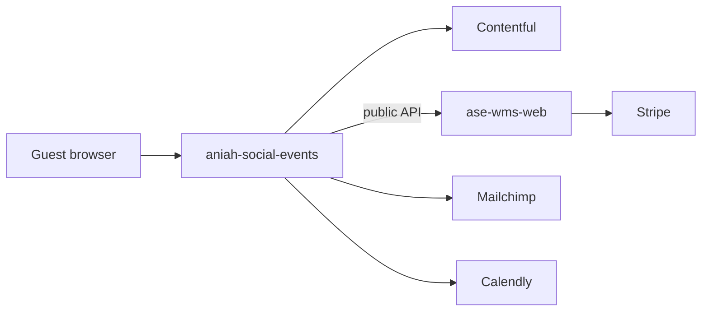
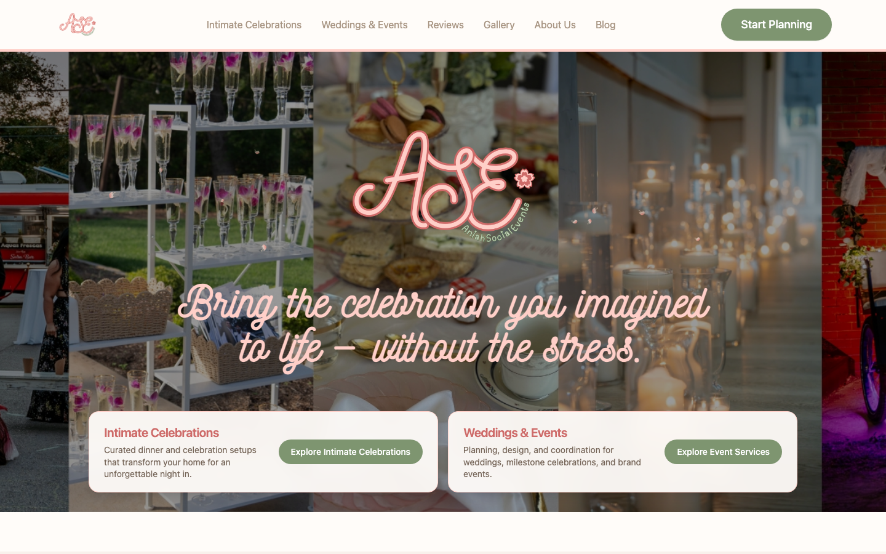
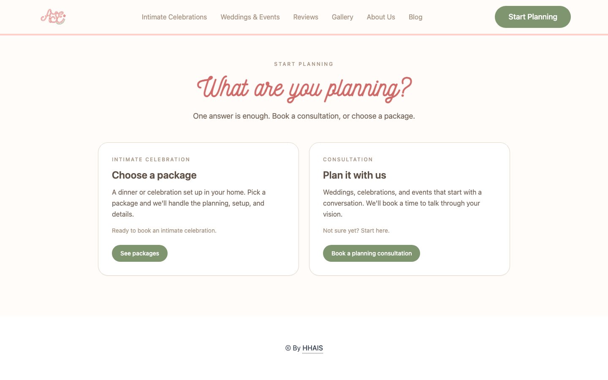
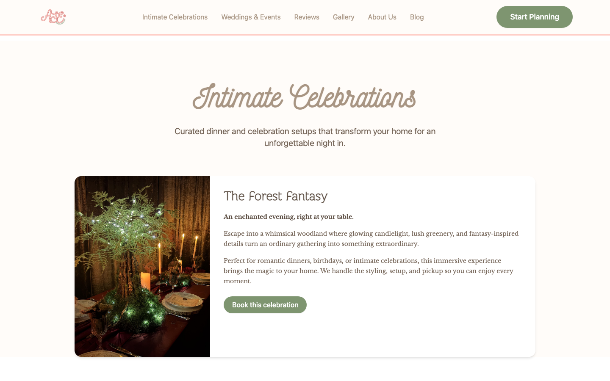
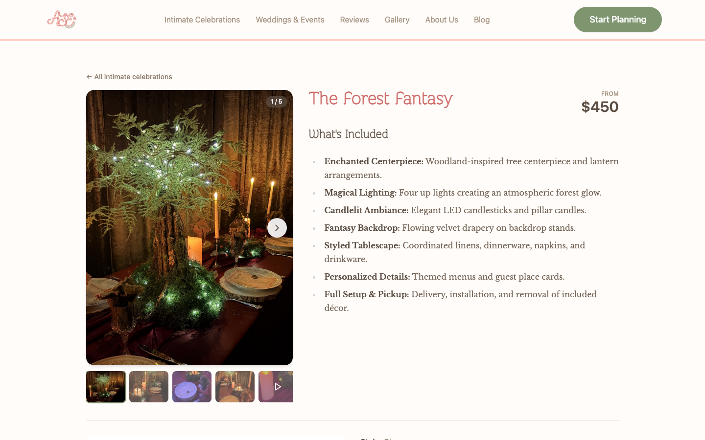
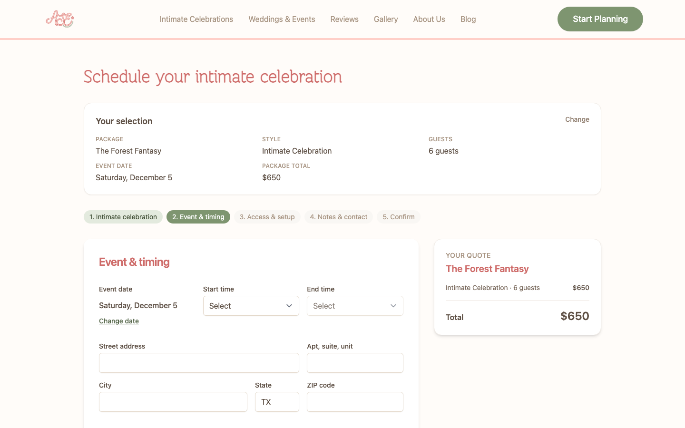

# Aniah Social Events

Public marketing and booking site for [Aniah’s Social Events Co.](https://www.aniahsocialevents.com) — wedding and event planning in Austin and San Antonio.

This repo is the guest-facing site. It has no customer accounts and no database of its own. Marketing pages come from Contentful. Intimate-celebration packages, dates, booking photos, and Stripe checkout go through the warehouse admin API in [`ase-wms-web`](https://github.com/agustindevelops/ase-wms-web). Warehouse staff later fulfill those orders in [`ase-wms-app`](https://github.com/agustindevelops/ase-wms-app).

| Piece | Repo | Role |
| --- | --- | --- |
| This site | [`aniah-social-events`](https://github.com/agustindevelops/aniah-social-events) | Marketing, gallery, blog, and guest booking |
| WIS admin + API | [`ase-wms-web`](https://github.com/agustindevelops/ase-wms-web) | Catalog, packages, orders, Stripe, PostgreSQL |
| WIS phone app | [`ase-wms-app`](https://github.com/agustindevelops/ase-wms-app) | Floor cataloging, QR labels, pickup and return |

Live site: [aniahsocialevents.com](https://www.aniahsocialevents.com)



The phone app never calls this site. Orders created here are stored in `ase-wms-web` and show up on the warehouse floor as today’s pickup.

## What a guest does

A visitor browses the brand, then either books an at-home **intimate celebration** (package, date, photos, pay with Stripe) or a **planning consultation** on Calendly for weddings and larger events.

### Home



The homepage is Contentful-driven: hero, who it is for, how it works, featured packages, services, gallery, testimonials, FAQ, and contact. **Start Planning** goes to `/schedule`.

### Start planning



Two paths:

- **Choose a package** → `/intimate-celebrations` (dinner setups booked and paid on the site)
- **Plan it with us** → `/schedule/appointment` (Calendly embed for weddings and larger events)

### Intimate celebrations catalog



`GET /api/public/{organizationId}/packages` on `ase-wms-web` fills this list. Package copy, photos, styles, and prices are edited in the WIS admin, not in this repo.

### One package



`/intimate-celebrations/{slug}` loads one package from the same public API. The guest picks a style, guest count, and date. Booked days come from `GET /api/public/{organizationId}/event-dates-booked`. The on-page quote is a preview; the admin server recalculates the total at checkout.

Pricing and timing live in `src/lib/booking/atHomeExperience/`. That folder is kept identical to `ase-wms-web/src/lib/order/atHomeExperience/` so the preview and Stripe charge agree.

### Booking form



`/schedule/intimate-celebration` is step two. The guest fills event timing, access, notes, and contact, then this site `POST`s the facts to `ase-wms-web` (`/api/public/{organizationId}/orders`) and sends the browser to Stripe Checkout. Photos upload to `/api/public/{organizationId}/uploads` when the style needs them. Stripe keys and the webhook live on the admin. Success returns to `/intimate-celebrations/booked`.

This site does not submit a booking in local README captures; the screenshot is an empty form on a selected package.

## How it connects

Client: [`src/lib/ase-admin/client.ts`](src/lib/ase-admin/client.ts) builds `{NEXT_PUBLIC_ASE_ADMIN_URL}/api/public/{NEXT_PUBLIC_ASE_ADMIN_ORGANIZATION_ID}/`.

| Call | Used for |
| --- | --- |
| `GET packages` / `GET packages/{slug}` | Catalog and package pages |
| `GET event-dates-booked` | Calendar on the package page |
| `POST uploads` | Booking photos |
| `POST orders` | Create a `PAYMENT_PENDING` order and Stripe URL |
| `GET orders/checkout/{sessionId}` | Confirmation after payment |

Other exterior services:

| Service | What it does here |
| --- | --- |
| Contentful | Home, services, gallery, blog, FAQ |
| Stripe | Hosted Checkout, created by `ase-wms-web` |
| Calendly | `/schedule/appointment` |
| Mailchimp | Email signup (`POST /api/subscribe`) |
| Eventbrite | Blossoms & Brews ticket CTA |
| Google Maps / Tag Manager | Venue embed and analytics |

There is no Firebase, Prisma, or warehouse UI in this repo.

## Getting started

```bash
cp .env.example .env.local
# set NEXT_PUBLIC_ASE_ADMIN_URL and NEXT_PUBLIC_ASE_ADMIN_ORGANIZATION_ID
# plus Contentful, Mailchimp, and Google keys used in src/
yarn install
yarn dev
```

Open [http://localhost:3000](http://localhost:3000). Node 24+. `ase-wms-web` also defaults to port 3000, so run one of them on another port when both are local (for example `next dev -p 3001` here, and point `NEXT_PUBLIC_ASE_ADMIN_URL` at `http://localhost:3000`).

| Command | Description |
| --- | --- |
| `yarn dev` | Next.js 15 App Router |
| `yarn build` | Production build + sitemap |
| `yarn generate:types` | Contentful content types |
